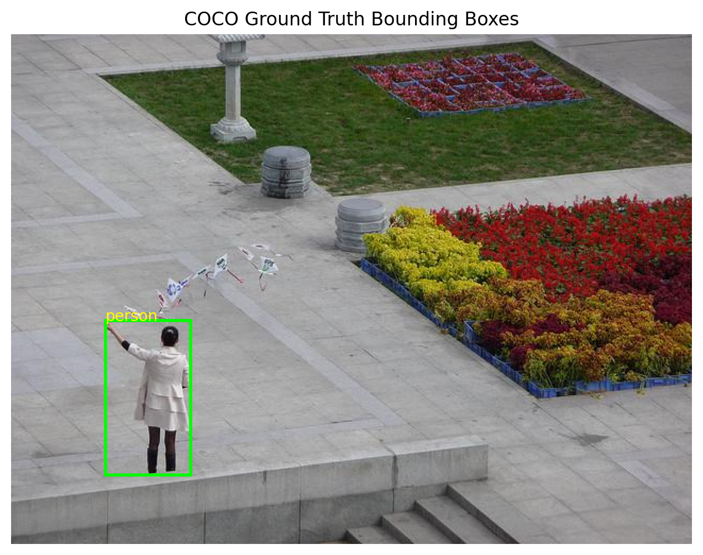
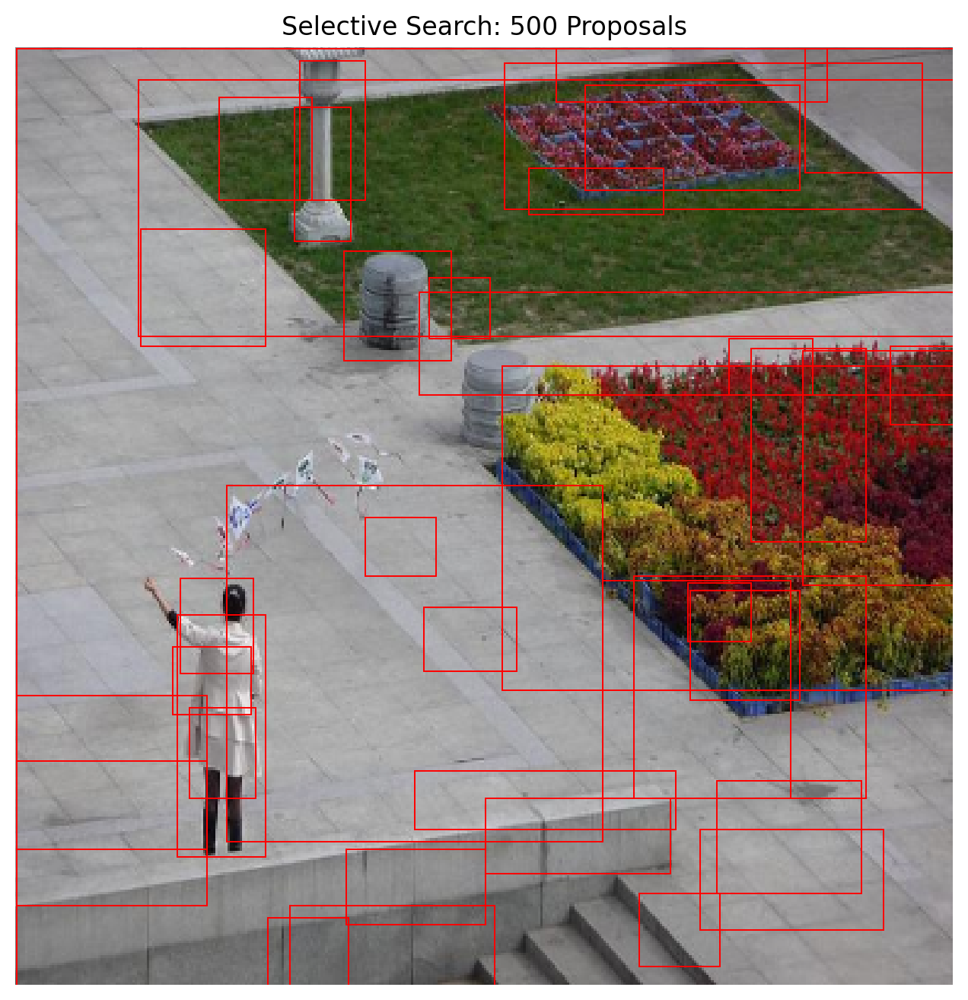
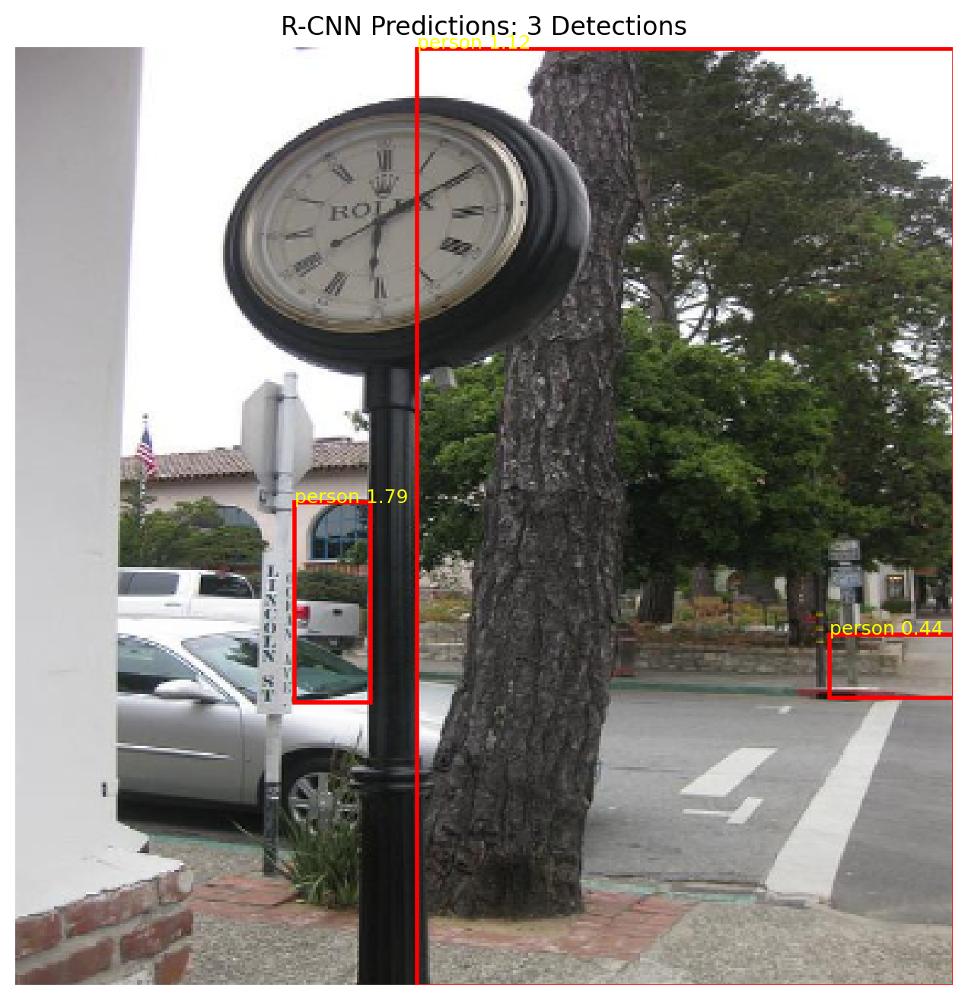
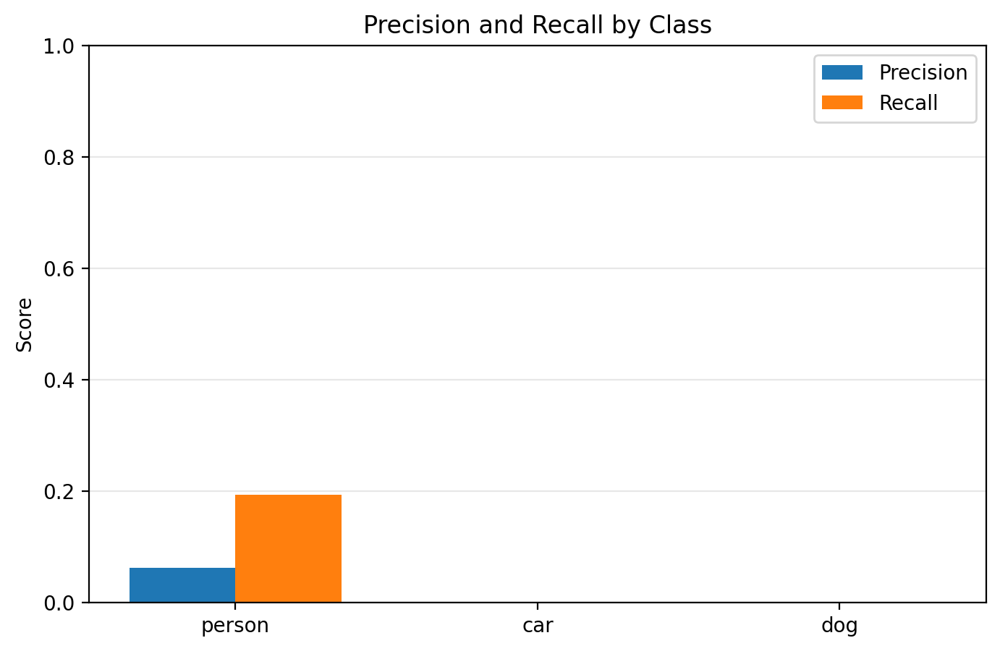

# Computer Vision Lab 02 — R-CNN Object Detection

An educational implementation and study of Region-based Convolutional Neural Networks (R-CNN) for object detection using PyTorch and OpenCV.

## 📌 Project Overview

This project explores the R-CNN family of object detection architectures, focusing on the original R-CNN pipeline and its evolution toward more advanced detection methods.

The project is organized into two Jupyter notebooks:

### 1. Original R-CNN Implementation

**Notebook:** `LAB_02_Original_RCNN.ipynb`

Implements the main stages of the original R-CNN detection pipeline:

- Dataset preparation using COCO128.
- Selective Search for region proposals.
- Intersection over Union (IoU) calculation.
- CNN feature extraction using a pretrained ResNet18.
- Linear SVM for region classification.
- Non-Maximum Suppression (NMS).
- Object detection evaluation using Precision, Recall, AP@0.5, and mAP@0.5.

### 2. R-CNN Family Study

**Notebook:** `RCNN_Object_Detection_Study.ipynb`

Explores the evolution of region-based object detection:

- Original R-CNN.
- Fast R-CNN concepts and experimental approximation.
- Faster R-CNN using pretrained models.
- Mask R-CNN using pretrained models.
- RoI Pooling and RoIAlign concepts.
- Model inference and performance comparison.

> Note: The comparative notebook is an educational study. The Faster R-CNN and Mask R-CNN experiments use pretrained models rather than training these architectures from scratch.

## 🛠️ Technologies Used

- Python
- PyTorch
- Torchvision
- OpenCV
- Scikit-learn
- NumPy
- Matplotlib
- Jupyter Notebook

## 📂 Project Structure

```text
Computer-Vision-Lab2-RCNN/
│
├── README.md
│
├── LAB_02_Original_RCNN.ipynb
│
├── RCNN_Object_Detection_Study.ipynb
│
├── detection_evaluation.csv
│
└── screenshots/
    ├── ground_truth.png
    ├── selective_search.png
    ├── final_detections.png
    └── precision_recall.png
```

## ⚙️ Installation

Install the required Python libraries:

```bash
pip install torch torchvision opencv-contrib-python numpy matplotlib scikit-learn jupyter pandas tqdm
```

Launch Jupyter Notebook:

```bash
jupyter notebook
```

Open the notebook you want to run.

## 📊 Original R-CNN Evaluation Results

The original R-CNN implementation was evaluated on three object classes: Person, Car, and Dog.

| Class | Ground Truth | Detections | Precision | Recall | AP@0.5 |
|:---|---:|---:|---:|---:|---:|
| Person | 53 | 119 | 0.0336 | 0.0755 | 0.0082 |
| Car | 1 | 3 | 0.0000 | 0.0000 | 0.0000 |
| Dog | 1 | 1 | 0.0000 | 0.0000 | 0.0000 |

**Overall mAP@0.5: 0.003**

The results reflect the experimental limitations of this implementation, including the small dataset subset, limited region proposals, and simplified training pipeline.

## ⏱️ R-CNN Family Performance Comparison

The following execution times were recorded during the comparative experiments.

| Method | Execution Time (seconds) |
|:---|---:|
| Selective Search | 6.154725 |
| R-CNN (12 Regions) | 0.151733 |
| R-CNN (24 Regions) | 0.332225 |
| Fast R-CNN Approximation | 0.034248 |
| Faster R-CNN | 0.690729 |
| Mask R-CNN | 0.297380 |

*Execution times are experimental measurements and may vary depending on hardware, input images, and execution environment.*

## 🖼️ Results and Visualizations

### Ground Truth Annotations



### Selective Search Proposals



### Final Object Detections



### Precision-Recall Curve



## ⚠️ Limitations

- The implementation uses a limited subset of the COCO128 dataset.
- Only three object classes are considered: Person, Car, and Dog.
- A pretrained ResNet18 is used as a frozen feature extractor.
- Linear SVM is used for region classification.
- Bounding box regression is not implemented.
- The number of region proposals is limited for computational efficiency.
- The implementation is an educational approximation and not a complete reproduction of the original R-CNN research paper.

## 🎯 Learning Objectives

- Understand region-based object detection.
- Explore Selective Search and region proposals.
- Understand CNN-based feature extraction.
- Apply SVM classification to object detection.
- Understand Non-Maximum Suppression.
- Compare the evolution of R-CNN-based architectures.
- Evaluate object detection performance using Precision, Recall, AP, and mAP.

## 👨‍💻 Author

**NourEddine BenAttous**

MSc Student in Artificial Intelligence & Data Science 🇩🇿


---

**Computer Vision Lab 02 — Object Detection Using R-CNN**

*Learning, experimenting, and exploring computer vision techniques.*
